<div align="center">

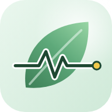

# 🌿 EcoPulse — *progress, not perfection*

**A calm, optimistic sustainability companion.** Log small eco actions, build streaks, estimate your carbon footprint, join challenges, earn badges and learn — all on your device, no account, no guilt. 💚

[](https://jaineil32624.github.io/EcoPulse/)
[](https://github.com/jaineil32624/EcoPulse/releases/latest/download/EcoPulse.apk)
[](https://github.com/jaineil32624/EcoPulse/releases/latest)


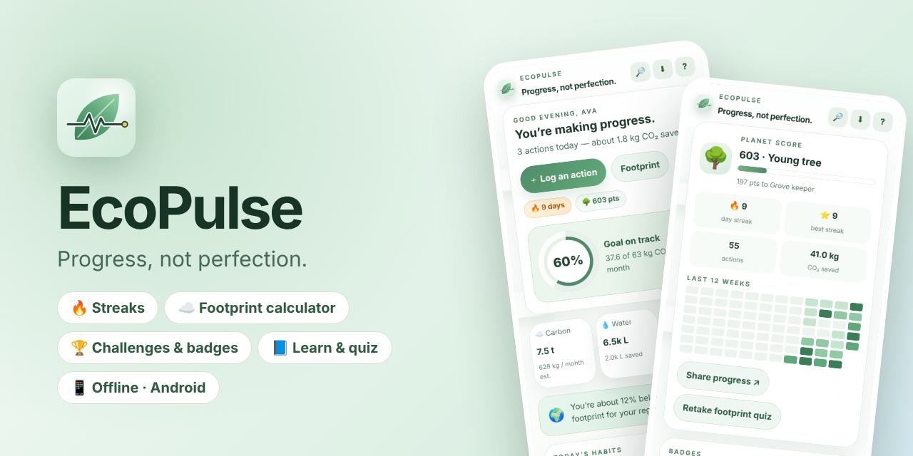

</div>

---

## ✨ Features

| | Feature | What it does |
|---|---|---|
| 👋 | **Friendly onboarding** | A 1-minute quiz (commute, diet, energy, recycling, flights…) builds your baseline footprint and goals |
| ☁️ | **Footprint calculator** | Carbon (t/yr + kg/month), water and waste score — change any answer and watch it update live, with a breakdown |
| ✅ | **19 eco actions** | Energy, transport, food and waste — each with impact, difficulty, time and a plain-language “why it helps” |
| 📌 | **Habit tracker** | Pin actions as daily habits and see a 7-day completion grid |
| 🔥 | **Streaks & Planet Score** | Daily streaks, best streak and a Planet Score that levels you up from 🌱 Seedling to 🏞️ Forest guardian |
| 🎯 | **Goal ring** | Your chosen goal (cut 10% CO₂, halve food waste, 20 actions/month…) drives the progress ring |
| 📊 | **Charts** | Interactive 7-day bars, a 30-day cumulative trend line and a 12-week activity heatmap |
| 🏆 | **Challenges** | Car-free day, zero plastic, plant-based weekend… join solo or with friends, check in, earn XP |
| 🏅 | **11 badges** | Unlock with a celebration — first step, 7-day streak, well-rounded, quiz ace and more |
| 💬 | **Community** | Share wins, cheer others, RSVP to local events, watch the collective impact meter grow |
| 📘 | **Learn** | Expandable explainers, flip-card myth vs fact, and a 5-question quiz |
| ↩️ | **Undo everywhere** | Every log, leave or reset shows a toast with Undo |
| ⌨️ | **Keyboard shortcuts** | `L` log · `1–5` tabs · `/` search · `Ctrl K` command palette · `F` footprint · `S` share · `G` get app · `?` help |
| 🔗 | **Share & deep links** | Share your progress (Web Share or clipboard); `#actions`, `#community`… open a tab directly |
| 💾 | **Your data, your device** | Saved in localStorage, export/import a JSON backup, anonymous mode, reduce-motion and sound toggles |

## 📸 Screenshots

<table>
<tr>
<td>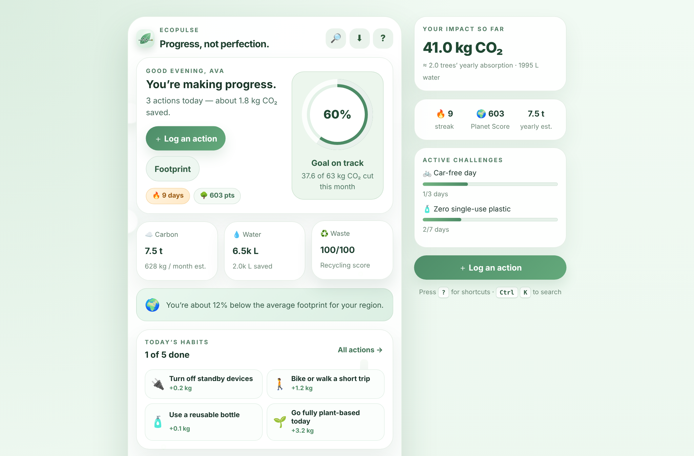<p align="center">🌿 <b>Home dashboard</b> — goal ring, stats, streaks</p></td>
<td>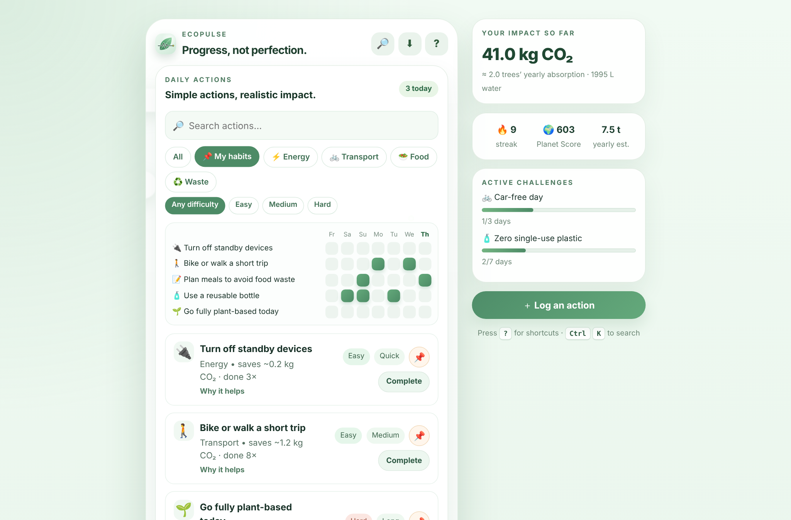<p align="center">✅ <b>Actions</b> — filters & habit tracker</p></td>
</tr>
<tr>
<td>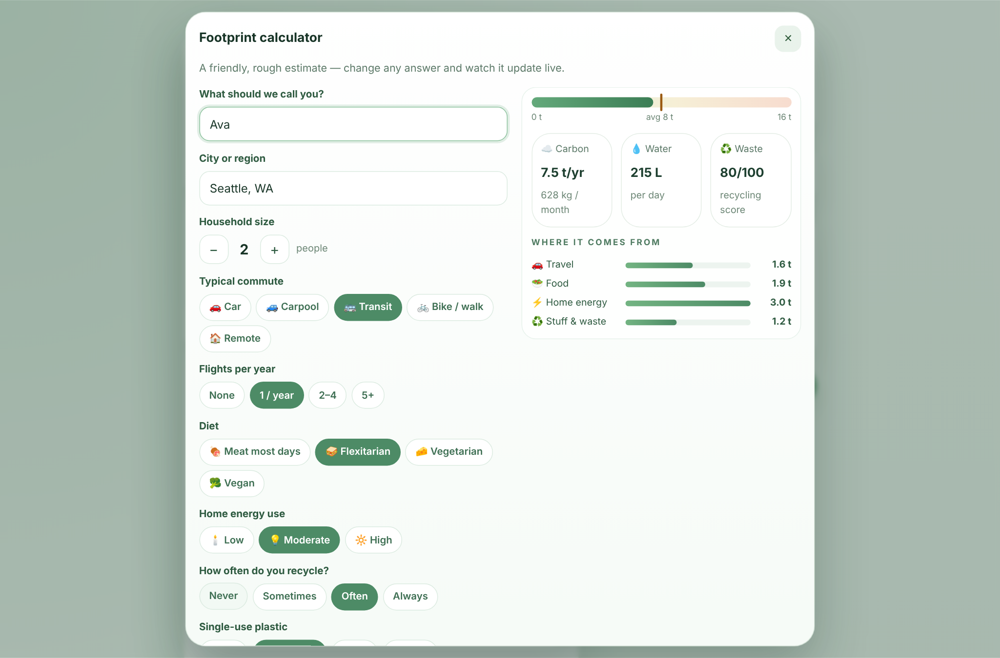<p align="center">☁️ <b>Footprint calculator</b> — live estimate</p></td>
<td>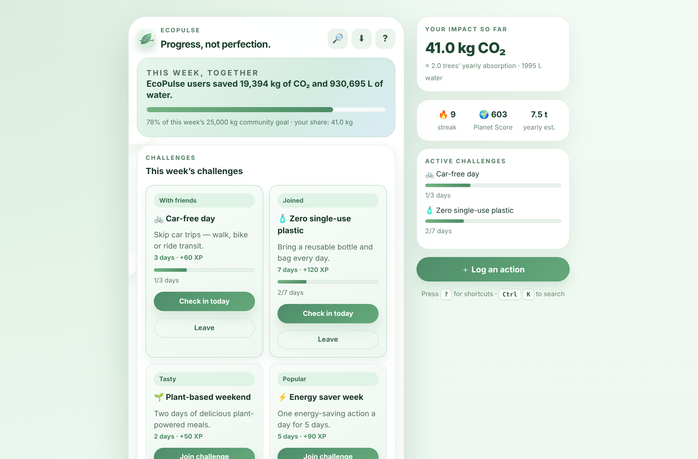<p align="center">🏆 <b>Challenges</b> & community impact</p></td>
</tr>
<tr>
<td>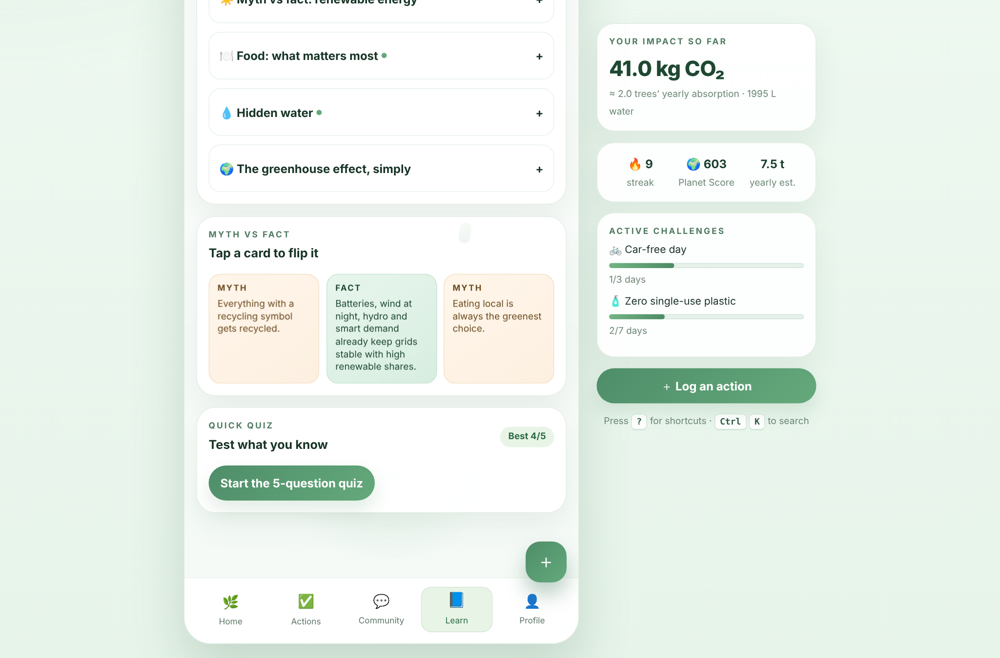<p align="center">📘 <b>Learn</b> — myth vs fact & quiz</p></td>
<td>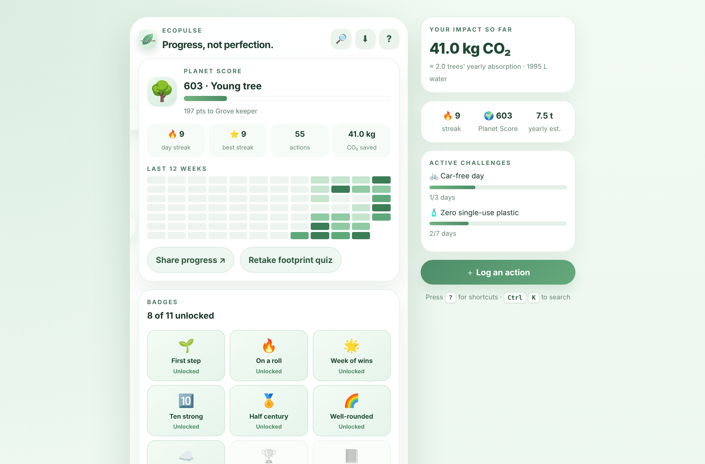<p align="center">🏅 <b>Profile</b> — Planet Score, heatmap, badges</p></td>
</tr>
<tr>
<td>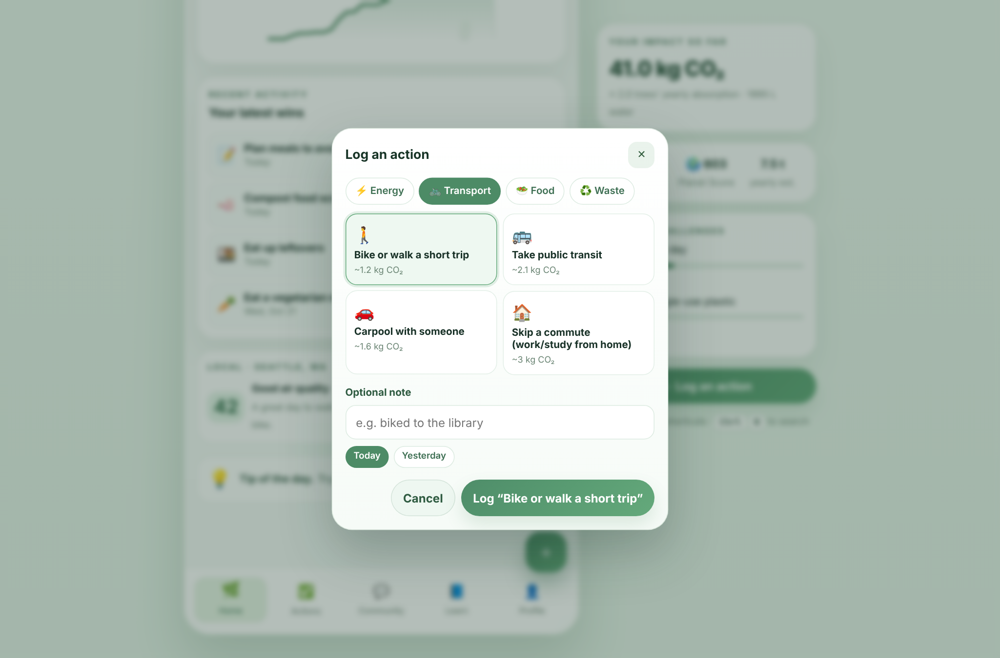<p align="center">➕ <b>Log an action</b> with a note</p></td>
<td>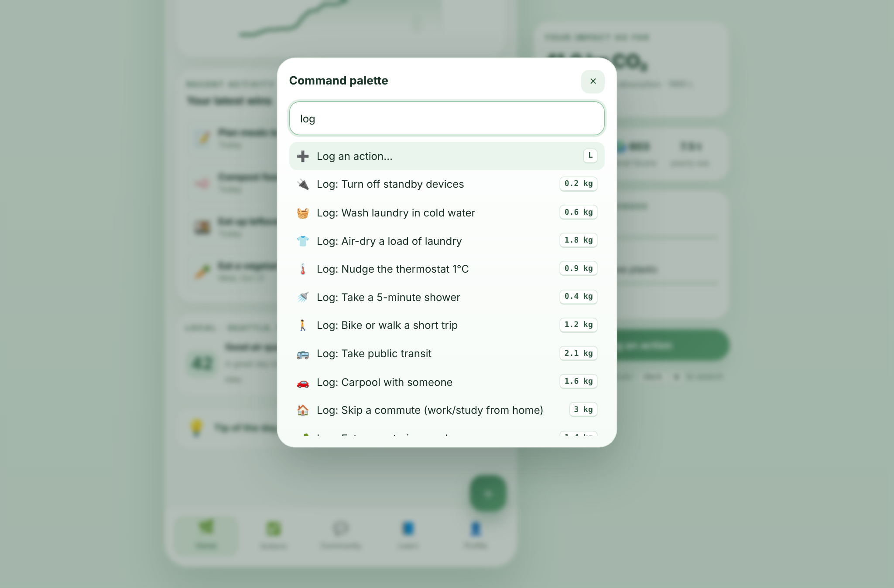<p align="center">⌨️ <b>Command palette</b> (Ctrl K)</p></td>
</tr>
</table>

<p align="center">
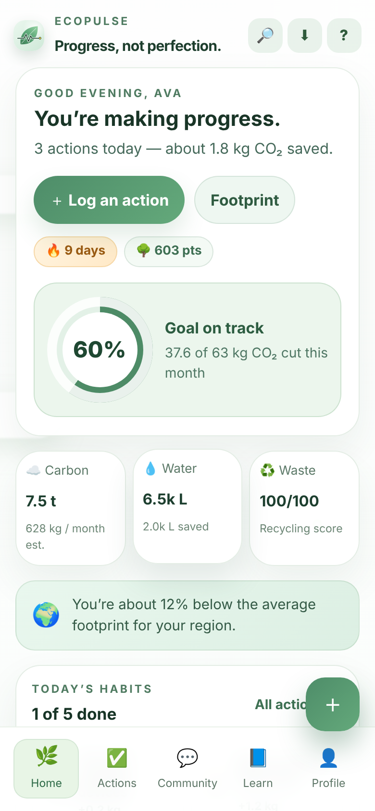
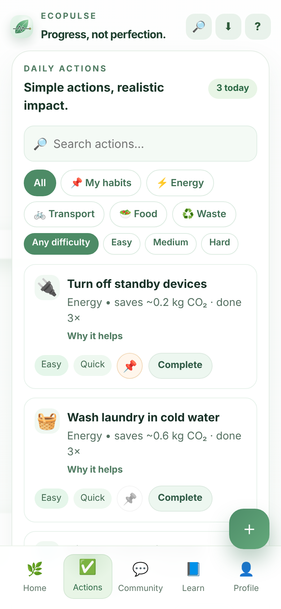
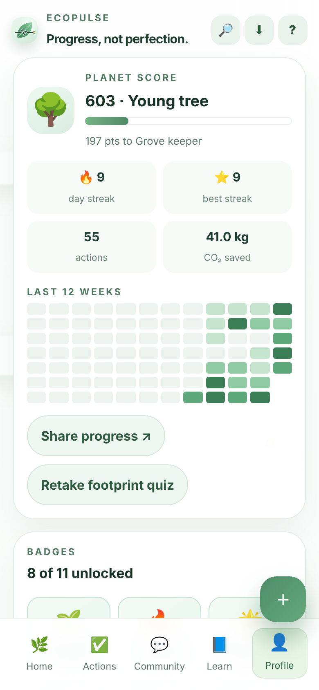
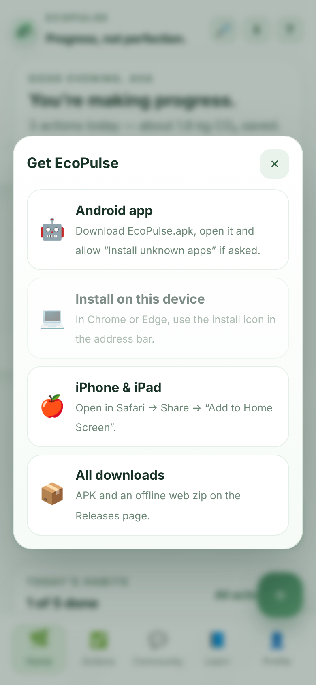
<br><em>📱 Mobile-first — big tap targets, bottom navigation and a floating ＋ button</em>
</p>

## 📥 Get EcoPulse

| Platform | How |
|---|---|
| 🌐 **Web** | Open **[jaineil32624.github.io/EcoPulse](https://jaineil32624.github.io/EcoPulse/)** — nothing to install |
| 🤖 **Android** | Download **[EcoPulse.apk](https://github.com/jaineil32624/EcoPulse/releases/latest/download/EcoPulse.apk)** → open it → allow *Install unknown apps* if asked |
| 💻 **Windows / Mac / Chromebook** | Open the website in Chrome or Edge → **⬇ Get the app** → **Install** |
| 🍎 **iPhone / iPad** | Open the website in Safari → **Share** → **Add to Home Screen** |
| 📦 **Offline zip** | Grab **EcoPulse-web.zip** from [Releases](https://github.com/jaineil32624/EcoPulse/releases/latest), unzip and serve the folder |

> 💡 Works **offline** once installed. No account, no ads, no tracking — everything stays on your device.

## 🛠️ Run it locally

```bash
git clone https://github.com/jaineil32624/EcoPulse.git
cd EcoPulse
npm install
npm run dev        # dev server with hot reload
npm run build      # type-check + production build into dist/
```

## 🗂️ Project structure

```
EcoPulse/
├── index.html                 🧱 Vite entry + PWA / social meta tags
├── src/
│   ├── main.tsx               🚀 React root + service-worker registration
│   ├── App.tsx                🧭 state, tabs, shortcuts, toasts, badges, dialogs
│   ├── App.css / index.css    🎨 styles
│   ├── data.ts                🌱 actions, challenges, badges, learn cards, footprint model
│   ├── store.ts               💾 localStorage, streaks, Planet Score, levels
│   ├── fx.ts                  ✨ leaf burst, chime, share/copy, downloads
│   ├── screens/               📱 Home, Actions, Community, Learn, Profile
│   └── components/            🧩 charts, dialogs, footprint form
├── public/
│   ├── manifest.webmanifest   📲 installable-app manifest
│   ├── sw.js                  📴 offline service worker
│   └── icons/                 🖼️ app icons (SVG + PNG + maskable)
├── docs/screenshots/          📸 images for this README
├── EcoPulse-product-spec.md   📝 product concept
├── VERSION                    🏷️ bump to publish a new release
└── .github/workflows/
    ├── pages.yml              🌐 build + deploy GitHub Pages
    └── release.yml            🤖 builds the Android APK + publishes a Release
```

## 🚀 Releasing a new version

Bump the number in `VERSION` and push — GitHub Actions builds the web app, wraps it with Capacitor and publishes the release automatically:

```bash
echo "1.1.0" > VERSION
git commit -am "Release 1.1.0" && git push
```

---

<p align="center">Made with 💚 by <b>Jaineil Rana</b> · <a href="https://github.com/jaineil32624">@jaineil32624</a></p>
